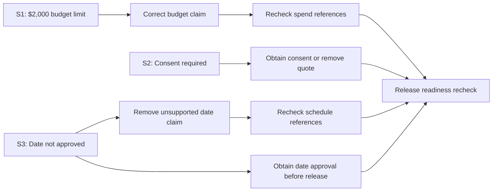

# Examples

## Example 1: campaign acceptance decision

A near-final Second-Pass Audit campaign package looked ready. It contained article copy, distribution assets, metadata, links, and a launch plan.

A direct comparison against the governing decisions found stale positioning, the wrong CTA, the wrong public decision labels, an outdated URL, and a proof claim stronger than the available record supported.

**Decision: HOLD** until the material issues were corrected and rechecked.

This is a worked example, not proof of universal accuracy, speed, revenue, or performance improvement.

## Example 2: lost qualifier

**Source**

> Customer interviews suggest this workflow may be useful for experienced operators. The sample is small and does not establish broad adoption.

**AI-assisted summary**

> Customers validated the workflow and are broadly adopting it.

**Decision: REVISE**

**Issue:** The output strengthened a limited observation into a broad adoption claim.

**Correction:** Early customer interviews suggest the workflow may be useful for experienced operators, but the small sample does not establish broad adoption.

## Example 3: proposal review

**Requirement**

A project must include a named deliverable, defined exclusions, payment schedule, completion criteria, and change-order process.

**Proposal**

The proposal describes the deliverable and payment schedule but does not define exclusions or change-order handling.

**Decision: REVISE or HOLD**, depending on consequence.

The audit does not establish whether the vendor is trustworthy. It identifies decision-relevant gaps before acceptance.

## Example 4: optional visual explanation

*Illustrative example. These source labels and figures are invented solely to demonstrate the method.*

**Governing sources**

- **S1 — Budget rule:** the campaign spend limit is **$2,000**.
- **S2 — Quote policy:** a customer quote cannot be published until consent is documented.
- **S3 — Launch decision:** publication requires an approved launch date, and none has been approved.

**Draft:** The campaign claims a **$2,500** budget, includes the quote for publication, and announces launch next Monday.

**Source-grounded findings**

| Source | Issue | Required action | Classification |
| --- | --- | --- | --- |
| S1 | Budget exceeds the documented limit | Correct to $2,000 and recheck spending references | Known defect; correction can start now |
| S2 | Publication consent is not documented | Obtain consent or remove quote; recheck published copy | Unresolved release prerequisite |
| S3 | Draft announces an unapproved date, and release approval is absent | Remove the unsupported date claim now; obtain date approval before release; recheck schedule references | Known claim defect and unresolved release prerequisite |

**Optional visual relationship map**

The paths are independent. The diagram does not invent an order between consent and date approval, and neither approval prevents immediate correction of the budget or unsupported date claim.

**Decision: HOLD.** The package is not ready for publication until release requirements are resolved and affected content is rechecked. The diagram explains the known facts but is not independent evidence.

